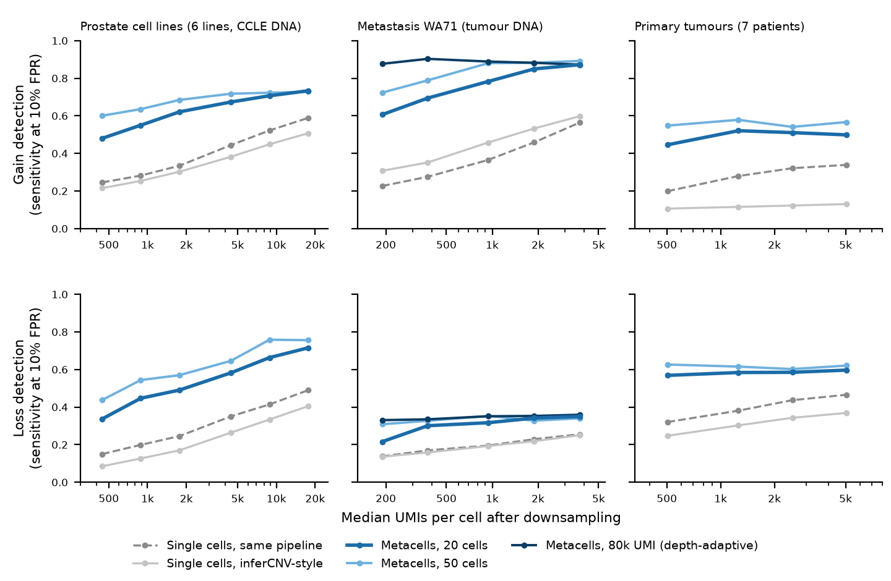
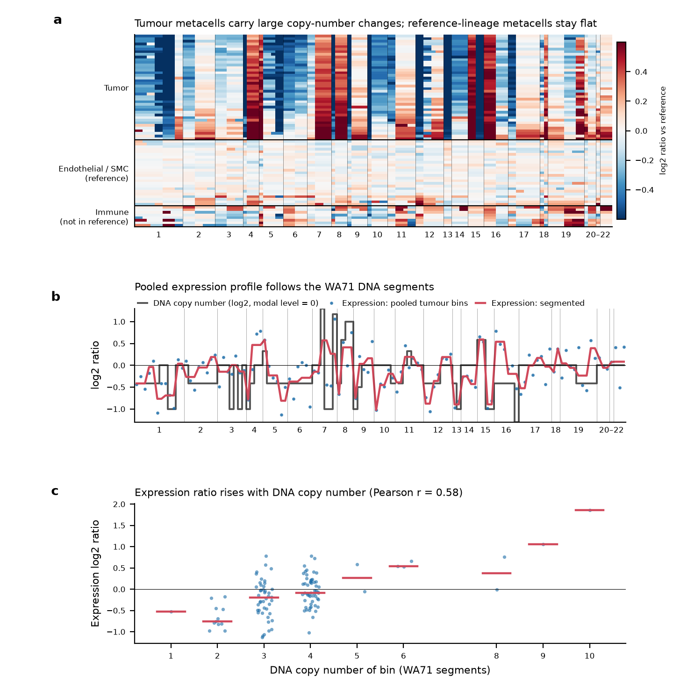
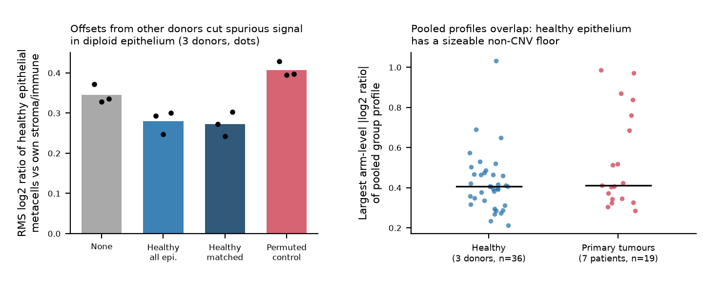
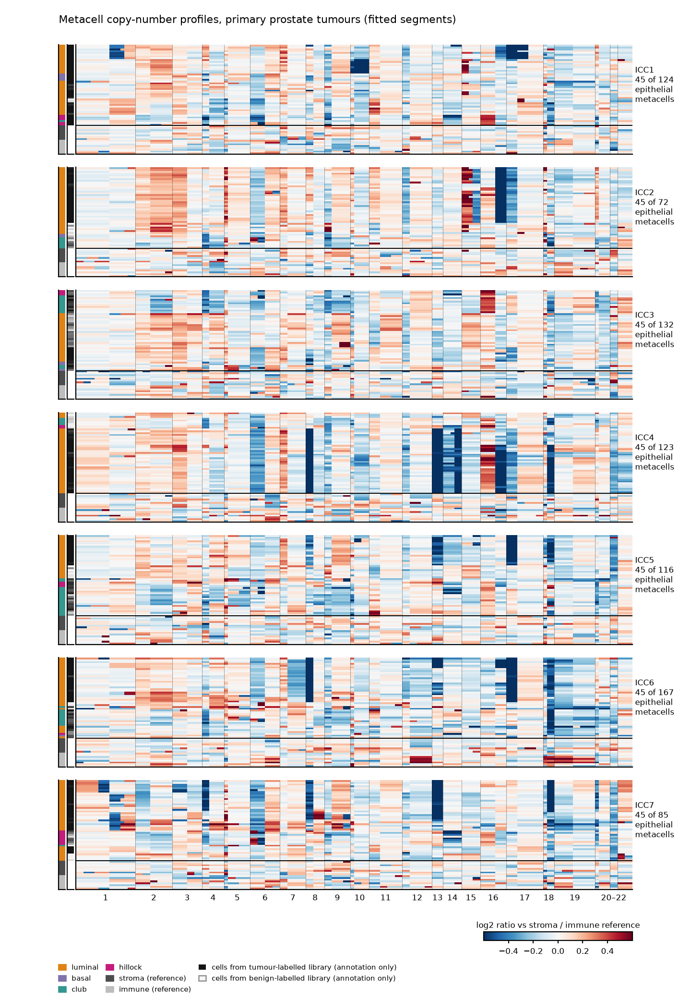

sccnv: summary of testing
================

- [1. What was tested](#1-what-was-tested)
- [2. Unit tests](#2-unit-tests)
- [3. Depth downsampling](#3-depth-downsampling)
- [4. Agreement with DNA copy number
  (WA71)](#4-agreement-with-dna-copy-number-wa71)
- [5. Negative controls](#5-negative-controls)
  - [5.1 Held-out diploid reference
    cells](#51-held-out-diploid-reference-cells)
  - [5.2 Healthy prostate epithelium,
    leave-one-donor-out](#52-healthy-prostate-epithelium-leave-one-donor-out)
  - [5.3 Does the offset help detection in
    WA71?](#53-does-the-offset-help-detection-in-wa71)
- [6. Primary tumours (no DNA
  available)](#6-primary-tumours-no-dna-available)
- [7. Known limitations](#7-known-limitations)
- [8. Reproducibility and run-to-run
  variability](#8-reproducibility-and-run-to-run-variability)
- [9. Reproducing this report](#9-reproducing-this-report)

This report summarises how the pipeline in `sccnv/` was tested. Every
number below is computed from the result tables in `results/reference/`
when the report is knitted; nothing is typed in by hand. Those tables
were produced by the scripts in `scripts/` (see the README for the
mapping and for the provenance caveats). The statistics are descriptive;
no confidence intervals or multiple-testing corrections were computed,
and the sample sizes are small (6 scored cell lines, 1 metastasis, 7
primary tumours, 3 healthy donors).

# 1. What was tested

| Level | Data | Truth | Question |
|----|----|----|----|
| Unit tests | simulated Poisson counts on a toy genome | known gain and loss | does the code behave as specified? |
| Cell-line mixture | 6 prostate cancer lines (scored) + PrEC (reference) + PNT2 (in the object, not scored; 10x 3’) | CCLE DNA copy number (WGS or SNP6) | does expression recover copy number? |
| Metastasis (WA71) | lymph-node metastasis, tumour + endothelial/SMC/immune cells | tumour DNA segment table | same, in a real tumour with stroma and immune cells |
| Depth downsampling | the three sets above | as above | do metacells keep sensitivity at low UMI depth? |
| Healthy prostate | 3 donors, 5 libraries (10x 3’ v2) | diploid by assumption | false-positive control; lineage offsets |
| Primary tumours | 7 patients, benign + tumour library each | none (no DNA) | descriptive only |

# 2. Unit tests

`pytest` ran 18 tests with 0 failures
(`results/reference/pytest_report.txt`). They use simulated counts, so
they test the code, not the biology:

| file | test |
|:---|:---|
| test_benchmark_offsets.py | truth classes and mode center |
| test_benchmark_offsets.py | eval profiles perfect and null predictions |
| test_benchmark_offsets.py | truth threshold arguments are honoured |
| test_benchmark_offsets.py | segments to gene log2 and bin truth |
| test_benchmark_offsets.py | offset table recovers known shift and cancels donor effects |
| test_binning.py | bins are ordered within arms and sized as requested |
| test_binning.py | blacklist regex removes matching genes |
| test_counts.py | stochastic round is unbiased and integer |
| test_counts.py | downsample counts fraction |
| test_counts.py | split counts partitions every umi |
| test_pipeline.py | tumour gain and loss are recovered |
| test_pipeline.py | heldout diploid cells are not called |
| test_pipeline.py | reference metacells never cross groups |
| test_pipeline.py | cell matrix shape and dropped cells |
| test_pipeline.py | events recovered with and without count splitting |
| test_pipeline.py | lineage offset is applied to query metacells only |
| test_pipeline.py | run refuses to start without reference metacells |
| test_pipeline.py | null simulation yields no calls |

The simulation-based tests cover: recovery of a 1.6x gain and a 0.5x
loss with calls of the right sign; a null simulation (tumour =
reference) with no calls; no calls in held-out diploid cells; metacells
that never cross group labels; the lineage offset shifting query
metacells but not reference metacells; and recovery with and without
count splitting.

# 3. Depth downsampling

Each cell’s UMIs were thinned binomially to a fraction of the original
depth. Four methods were compared: single cells scored by this pipeline,
single cells scored by an inferCNV-style baseline (log-CPM,
reference-subtracted, running mean over 101 genes), and 20- or 50-cell
metacells built by this pipeline. Sensitivity is measured at a per-cell
false-positive rate of 10% on the truth-neutral bins of the same cell
(`sens_*_fpr10`). **That metric uses the truth to set the threshold,
which equalises false-positive rates across methods but is not a
deployable threshold.**



| dataset | depth | median UMI/cell | method | gain sensitivity | loss sensitivity | Pearson with truth |
|:---|:---|---:|:---|:---|:---|:---|
| cell lines (CCLE DNA) | full depth | 17653 | single-cell (pipeline) | 0.59 | 0.49 | 0.48 |
| cell lines (CCLE DNA) | full depth | 17653 | inferCNV-style (single cell) | 0.51 | 0.41 | 0.46 |
| cell lines (CCLE DNA) | full depth | 17653 | metacell-20 (pipeline) | 0.73 | 0.72 | 0.63 |
| cell lines (CCLE DNA) | full depth | 17653 | metacell-50 (pipeline) | 0.73 | 0.76 | 0.63 |
| cell lines (CCLE DNA) | lowest depth | 443 | single-cell (pipeline) | 0.25 | 0.15 | 0.16 |
| cell lines (CCLE DNA) | lowest depth | 443 | inferCNV-style (single cell) | 0.21 | 0.08 | 0.13 |
| cell lines (CCLE DNA) | lowest depth | 443 | metacell-20 (pipeline) | 0.48 | 0.34 | 0.36 |
| cell lines (CCLE DNA) | lowest depth | 443 | metacell-50 (pipeline) | 0.60 | 0.44 | 0.44 |
| WA71 metastasis, stroma ref (tumour DNA) | full depth | 3766 | single-cell (pipeline) | 0.56 | 0.26 | 0.34 |
| WA71 metastasis, stroma ref (tumour DNA) | full depth | 3766 | inferCNV-style (single cell) | 0.60 | 0.25 | 0.47 |
| WA71 metastasis, stroma ref (tumour DNA) | full depth | 3766 | metacell-20 (pipeline) | 0.87 | 0.35 | 0.43 |
| WA71 metastasis, stroma ref (tumour DNA) | full depth | 3766 | metacell-50 (pipeline) | 0.89 | 0.34 | 0.44 |
| WA71 metastasis, stroma ref (tumour DNA) | lowest depth | 189 | single-cell (pipeline) | 0.23 | 0.14 | 0.13 |
| WA71 metastasis, stroma ref (tumour DNA) | lowest depth | 189 | inferCNV-style (single cell) | 0.31 | 0.14 | 0.22 |
| WA71 metastasis, stroma ref (tumour DNA) | lowest depth | 189 | metacell-20 (pipeline) | 0.61 | 0.22 | 0.31 |
| WA71 metastasis, stroma ref (tumour DNA) | lowest depth | 189 | metacell-50 (pipeline) | 0.72 | 0.31 | 0.39 |
| primary tumours, split-half consensus | full depth | 5037 | single-cell (pipeline) | 0.34 | 0.47 | 0.37 |
| primary tumours, split-half consensus | full depth | 5037 | inferCNV-style (single cell) | 0.13 | 0.37 | 0.27 |
| primary tumours, split-half consensus | full depth | 5037 | metacell-20 (pipeline) | 0.50 | 0.60 | 0.52 |
| primary tumours, split-half consensus | full depth | 5037 | metacell-50 (pipeline) | 0.57 | 0.62 | 0.54 |
| primary tumours, split-half consensus | lowest depth | 504 | single-cell (pipeline) | 0.20 | 0.32 | 0.21 |
| primary tumours, split-half consensus | lowest depth | 504 | inferCNV-style (single cell) | 0.11 | 0.25 | 0.17 |
| primary tumours, split-half consensus | lowest depth | 504 | metacell-20 (pipeline) | 0.45 | 0.57 | 0.45 |
| primary tumours, split-half consensus | lowest depth | 504 | metacell-50 (pipeline) | 0.55 | 0.63 | 0.51 |

- **Metacells versus single cells at the lowest depth.** Gain
  sensitivity: cell lines 0.25 → 0.48; WA71 0.23 → 0.61; primary tumours
  0.20 → 0.45 (single cell → 20-cell metacell). Loss sensitivity
  improves in the same direction in all three sets.
- **WA71 matches full-depth single cells at about 5% of the depth.** A
  20-cell metacell at 189 UMI/cell has gain sensitivity 0.61, against
  0.56 for single cells at 3766 UMI/cell.
- **WA71: the gain comes from metacell aggregation, not from this
  pipeline’s single-cell scoring.** At full depth, single cells scored
  by the inferCNV-style baseline reach gain sensitivity 0.60 and Pearson
  0.47, against 0.56 and 0.34 for single cells in this pipeline; the
  20-cell metacells reach 0.87 and 0.43. The metacell profile also
  correlates less with truth than the baseline’s single-cell profile at
  full depth. In the cell lines, this pipeline’s single-cell mode is
  ahead of the baseline.
- **Loss detection in WA71 is weak for every method** (best 0.36). Most
  bins sit at copy number 3 or 4 (Section 4), so many losses are CN 3
  against a CN 4 baseline, where the expected log2 ratio is only about
  -0.4; this likely limits loss sensitivity.
- **Depth-adaptive metacells (WA71 only).** Sizing metacells to a UMI
  target gave the following gain sensitivities across depths:

| median UMI/cell | metacell-20 (pipeline) | metacell-80k UMI (pipeline) |
|----------------:|:-----------------------|:----------------------------|
|            3766 | 0.87                   | 0.87                        |
|            1886 | 0.85                   | 0.88                        |
|             942 | 0.78                   | 0.89                        |
|             377 | 0.69                   | 0.90                        |
|             189 | 0.61                   | 0.88                        |

- **Count splitting.** The 20-cell metacells with and without count
  splitting (`metacell-20 (pipeline)` versus
  `metacell-20, no count split`):

| dataset | median UMI/cell | method | gain sensitivity | loss sensitivity |
|:---|---:|:---|:---|:---|
| cell lines (CCLE DNA) | 443 | metacell-20 (pipeline) | 0.48 | 0.34 |
| cell lines (CCLE DNA) | 443 | metacell-20, no count split | 0.50 | 0.39 |
| WA71 metastasis, stroma ref (tumour DNA) | 189 | metacell-20 (pipeline) | 0.61 | 0.22 |
| WA71 metastasis, stroma ref (tumour DNA) | 189 | metacell-20, no count split | 0.53 | 0.24 |
| primary tumours, split-half consensus | 504 | metacell-20 (pipeline) | 0.45 | 0.57 |
| primary tumours, split-half consensus | 504 | metacell-20, no count split | 0.46 | 0.54 |

Count splitting has no consistent sensitivity cost in these data. Its
protection against false positives was **not measured directly**; the
protection is argued on theoretical grounds only.

# 4. Agreement with DNA copy number (WA71)



The pooled expression profile of the tumour metacells correlates with
the DNA copy number across bins (Pearson r = 0.58 with no offset).
Expression ratios rise with copy number overall, but the bins at copy
number 3 and 4 overlap strongly, and the extremes rest on very few bins
(one bin each at copy number 1, 9 and 10 in panel c). The DNA truth is
mode-centred (expression cannot give ploidy), so the comparison is
relative to the tumour’s modal level.

# 5. Negative controls

## 5.1 Held-out diploid reference cells

In the cell-line mixture, 30% of PrEC cells were held out of the
reference and kept as diploid test cells; in WA71, 20% of stromal and
immune cells were. The repository scripts do **not** write out the call
rate in these held-out cells on the real data, so there is no table here
to support a false-positive claim for them. The unit test
`heldout diploid cells are not called` checks the behaviour on simulated
counts only. The call threshold is chosen so that at most 2% of
leave-one-out reference metacells carry any call (`fp_target`); this is
a calibration target on the reference metacells themselves, not an
independent estimate of the false-positive rate. The independent
real-data check is the healthy-donor analysis in 5.2.

## 5.2 Healthy prostate epithelium, leave-one-donor-out

For each healthy donor, the epithelial offset was estimated from the
other two donors and applied to that donor’s epithelium, which was
analysed against that donor’s own stromal and immune cells.

| variant | metacells with any call | RMS log2 ratio | donors |
|:---|:---|:---|---:|
| control: all-epithelium offset, bins permuted | 7.8% | 0.408 | 3 |
| no offset | 5.0% | 0.345 | 3 |
| other donors, all-epithelium offset | 2.7% | 0.280 | 3 |
| other donors, matched-subtype offset | 2.9% | 0.273 | 3 |



Without an offset, 5.0% of healthy diploid epithelial metacells carry a
call, above the 2% reference calibration target, so the calibration on
the reference lineages does not carry over fully to epithelium. Offsets
from the other donors lower the RMS signal in diploid epithelium, and
the bin-permuted control raises it, so the offset carries real
structure. The improvement is partial. With only 3 donors, the
between-donor variance is poorly estimated.

## 5.3 Does the offset help detection in WA71?

| offset | gain sensitivity | loss sensitivity | pooled Pearson |
|:---|:---|:---|:---|
| no offset | 0.87 | 0.35 | 0.58 |
| healthy, all epithelium | 0.85 | 0.38 | 0.50 |
| healthy, all epithelium, no variance term | 0.87 | 0.39 | 0.50 |
| healthy, luminal | 0.88 | 0.24 | 0.51 |
| healthy, luminal, no variance term | 0.87 | 0.22 | 0.51 |
| healthy, basal | 0.75 | 0.34 | 0.51 |
| Wong benign-labelled luminal (3+ patients) | 0.85 | 0.20 | 0.53 |
| control: healthy all-epithelium offset, bins permuted | 0.40 | 0.28 | 0.53 |

Gain sensitivity with no offset is 0.87; the healthy-donor offsets give
0.75 to 0.88. Loss sensitivity is 0.35 without an offset and 0.24 to
0.38 with one. The pooled Pearson correlation with DNA is lower with
every healthy-donor offset (0.50 to 0.51, against 0.58). So none of the
offsets shows a consistent gain over no offset in WA71. The bin-permuted
control reduces gain sensitivity to 0.40, which shows that the offset’s
bin structure matters when it is applied. The offset is therefore
**unproven for this metastasis**.

# 6. Primary tumours (no DNA available)

There is no DNA for these samples, so there is no truth. The heatmap
shows metacell-level profiles after the healthy-donor, subtype-matched
offset. Rows above the black line are epithelial metacells, rows below
are leave-one-out stromal and immune reference metacells. The grey bar
next to the subtype bar shows the library label of the cells in each
metacell. It is annotation only and was not used in the analysis.



- **Group-level calls are not calibrated against healthy epithelium.**
  With the matched offset, 45 of 84 healthy diploid epithelial groups
  received at least one call, covering up to 64% of bins. Pooling lowers
  white noise, so structured non-copy-number expression differences
  dominate at the group level.
- **Pooled amplitudes overlap.** The largest arm-level \|log2 ratio\| of
  a group’s fitted profile has a median of 0.41 in 36 healthy groups and
  0.41 in 19 primary-tumour groups. 1 healthy group and 5 tumour groups
  exceed 0.75, so large events separate the two sets while the bulk of
  the distributions overlap. The healthy maximum is 1.03.
- **Strong events separate by library label, weaker ones do not.** For
  arms picked by eye from the heatmap, the table gives the median
  arm-level ratio of tumour-library versus benign-library metacells. The
  choice of arms is descriptive and not a calibrated test. Not every row
  separates: for ICC7 18q, 64.3% of benign-labelled-library metacells
  also show the loss. That could be tumour cells inside the benign
  library or a non-copy-number signal; without DNA the two cannot be
  told apart here.

| patient | arm | tumour-library metacells | median ratio (tumour lib.) | benign-library metacells | median ratio (benign lib.) | benign-lib. metacells below -0.25 |
|:---|:---|---:|:---|---:|:---|:---|
| ICC2 | 16q | 58 | -1.07 | 14 | -0.09 | 7.1% |
| ICC2 | 15q | 58 | 0.07 | 14 | -0.03 | 0.0% |
| ICC4 | 8p | 104 | -0.97 | 19 | 0.08 | 5.3% |
| ICC4 | 13q | 104 | -0.71 | 19 | 0.08 | 0.0% |
| ICC4 | 16q | 104 | -1.00 | 19 | -0.15 | 10.5% |
| ICC7 | 13q | 71 | -0.45 | 14 | 0.06 | 0.0% |
| ICC7 | 18q | 71 | -0.98 | 14 | -0.27 | 64.3% |

- **Shared vertical stripes across all seven patients** in the
  unsegmented heatmap (`fig_wong_metacell_heatmap_raw.png`) look like
  residual lineage or cell-state signal that the offset does not remove.
- **The depth-downsampling “truth” for primary tumours is not DNA.** It
  is a pooled full-depth expression profile built by this pipeline from
  the other half of each patient’s tumour-library epithelium. The
  within-pipeline comparison of metacells with single cells is fair; the
  comparison with the inferCNV-style baseline is biased towards this
  pipeline there. The healthy-epithelium comparison above shows that
  this profile contains non-copy-number structure, so the primary-tumour
  sensitivities should not be read as detection of true events.

# 7. Known limitations

1.  **Expression-only.** Ploidy, copy-neutral LOH and balanced gains are
    not identifiable. Truth profiles are mode-centred before comparison.
2.  **One metastasis with DNA.** WA71 is a single tumour; its low loss
    sensitivity is consistent with most losses being CN 3 against a CN 4
    baseline (log2 ratio about -0.4).
3.  **Primary tumours have no orthogonal truth.** Identity resolution
    (aneuploid versus diploid) by CNV is **not solved** at the metacell
    or group level; only strong, patient-specific events separate.
4.  **Offsets are estimated from 3 donors** (10x 3’ v2, one platform),
    transfer only partially and did not help in WA71.
5.  **Library labels.** `scripts/12_depth_wong_benign_library.py` still
    treats benign-labelled libraries as normal (for the offset and as a
    control). The label-free analysis is
    `scripts/30_wong_library_agnostic.py`.
6.  **Subclonal events smaller than one metacell are blurred** because
    cells in a metacell share its profile. This was not tested.
7.  **WA71 counts are non-integer** (ambient-corrected). They were
    stochastically rounded to integers for count splitting and thinning.
8.  **Threshold-free sensitivity uses the truth** (Section 3).
9.  **PNT2 is not scored.** The cell-line object holds eight labels.
    Besides the six cancer lines and the PrEC reference it contains
    1,269 PNT2 cells, an immortalised non-tumour line that has no
    copy-number entry in the CCLE study used for truth. These cells are
    processed as an unscored query group (they enter gene selection and
    downsampling) and are excluded from every metric. Their copy-number
    state is not established, so they are not used as a diploid control
    either.

# 8. Reproducibility and run-to-run variability

| file | rows matched | largest abs. difference | mean abs. difference |
|:---|---:|:---|:---|
| depth_experiment_celllines.csv | 324 | 0.0000 | 0.0000 |
| depth_experiment_summary.csv | 110 | 0.1227 | 0.0112 |
| depth_experiment_wa71_both.csv | 55 | 0.0000 | 0.0000 |
| depth_experiment_wa71_stroma.csv | 55 | 0.0000 | 0.0000 |
| group_amplitude_healthy_vs_wong.csv | 55 | 0.2765 | 0.0126 |
| healthy_lodo_negative_control.csv | 12 | 0.0000 | 0.0000 |
| wa71_healthy_offset_results.csv | 16 | 0.0000 | 0.0000 |
| wong_lineage_offset_negative_control.csv | 14 | 0.2500 | 0.0310 |

The table compares tables regenerated from this repository with those
from the first analysis run (before packaging); differences are in score
units (sensitivities, AUCs, correlations, log2 ratios). 5 of 8 files
reproduce exactly: depth_experiment_celllines.csv,
depth_experiment_wa71_both.csv, depth_experiment_wa71_stroma.csv,
healthy_lodo_negative_control.csv, wa71_healthy_offset_results.csv. The
remaining files all involve the primary-tumour analysis. The first run
seeded the per-patient subsampling with Python’s per-process salted
`hash()`, and the repository uses a stable seed, so the subsample
differs; the number of metacells in a group changed by at most 1.

Each depth in the downsampling experiment uses **one** binomial thinning
realisation. A second realisation at the shared depths
(`thinning_replicate_check.csv`) moved the mean sensitivities by up to
0.04 (gain: 0.04, loss: 0.01), whereas the metacell-minus-single-cell
gain difference at those depths is at least 0.23 (Section 3). No
confidence intervals were computed.

# 9. Reproducing this report

``` r
# from the repository root, after running the pipeline (see README)
rmarkdown::render("analysis/testing_summary.Rmd", output_format = c("github_document", "html_document"))
```

    ## R version 4.5.3 (2026-03-11)
    ## Platform: x86_64-conda-linux-gnu
    ## 
    ## Matrix products: default
    ## BLAS/LAPACK: /home/claude/.claude-science/conda/envs/seurat-test/lib/libopenblasp-r0.3.34.so;  LAPACK version 3.12.0
    ## 
    ## locale:
    ## [1] C
    ## 
    ## time zone: NA
    ## tzcode source: system (glibc)
    ## 
    ## attached base packages:
    ## [1] stats     graphics  grDevices utils     datasets  methods   base     
    ## 
    ## other attached packages:
    ## [1] tidyr_1.3.2 dplyr_1.2.1
    ## 
    ## loaded via a namespace (and not attached):
    ##  [1] digest_0.6.39    R6_2.6.1         fastmap_1.2.0    tidyselect_1.2.1
    ##  [5] xfun_0.61        magrittr_2.0.5   glue_1.8.1       tibble_3.3.1    
    ##  [9] knitr_1.52       pkgconfig_2.0.3  htmltools_0.5.9  rmarkdown_2.32  
    ## [13] generics_0.1.4   lifecycle_1.0.5  cli_3.6.6        vctrs_0.7.3     
    ## [17] withr_3.0.3      compiler_4.5.3   purrr_1.2.2      tools_4.5.3     
    ## [21] pillar_1.11.1    evaluate_1.0.5   yaml_2.3.12      otel_0.2.0      
    ## [25] rlang_1.3.0
